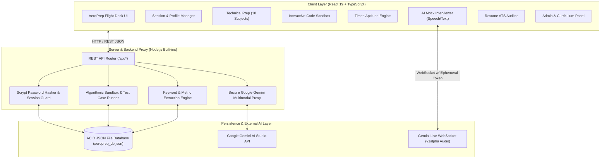
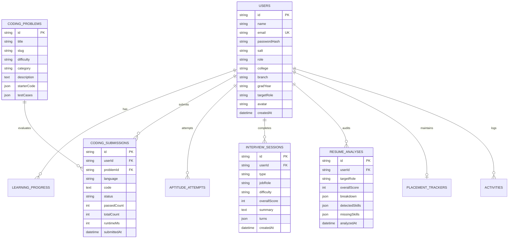

# AeroPrep — AI-Powered Student Career Preparation & Placement Platform
> **B.Tech Information Technology / Computer Science — Minor Project**  
> *Production-Ready Academic & SaaS Grade Interview Readiness Platform*

---

## 1. Project Title
**AeroPrep**: An Integrated AI-Driven Cognitive Placement Training, Technical Curriculum, Algorithmic Code Execution Sandbox, and Multimodal Interview Preparation Platform.

---

## 2. Abstract
Campus placement drives and technical hiring assessments present rigorous multi-stage evaluation pipelines including cognitive aptitude tests, core computer science domain evaluations, algorithmic programming assessments, and behavioral/technical interviews. Undergraduate engineering students frequently struggle due to fragmented resources, lack of automated code evaluation feedback, absent behavioral interview simulation, and non-transparent resume ATS screening.

**AeroPrep** is a unified, end-to-end career readiness EdTech platform engineered using modern web architectures (React 19, TypeScript, Node.js REST API, Google Gemini AI Multimodal APIs). The platform provides a structured, gamified preparation experience featuring:
1. **Core Technical Preparation** across 10 essential engineering subjects with interactive concept quizzes.
2. **Interactive Algorithmic Coding Practice Sandbox** supporting Python, Java, C++, and C with automated multi-testcase evaluation, runtime profiling, and submission history.
3. **Cognitive Aptitude Training** with timed full-length mock test simulators, question navigation palettes, and auto-submission engines.
4. **AI-Powered Multimodal Mock Interviewer** conducting real-time verbal and typed interviews with STAR rubric grading, missing concept detection, and model answers.
5. **Real-time Live Audio Communication Coach** leveraging Gemini Live WebSocket streaming.
6. **Resume ATS Readiness Auditor** that parses technical skills, evaluates project metric quantification, and diagnoses job-role alignment gaps.
7. **Placement Readiness Matrix & Company Tracker** allowing students to map target recruiter rounds (Google, Amazon, Microsoft, TCS Digital) against weekly milestones.
8. **Role-Based Admin Control Center** for faculty coordinators to manage curriculum, track student progress, and monitor platform submission metrics.

---

## 3. Problem Statement
1. **Curriculum Fragmentation:** Students navigate disparate websites for DSA practice, core CS theoretical revision, aptitude formulas, and interview tips.
2. **Absence of Real-Time Interview Feedback:** Traditional mock interviews require dedicated human mentors, which is unscalable for large universities.
3. **Unchecked Algorithmic Solutions:** Beginners lack immediate test case evaluation with realistic runtime profiling and time-limit checks.
4. **Ambiguous Resume Screening:** Students face high rejection rates in automated Applicant Tracking Systems (ATS) due to poor keyword density, unquantified project bullets, and missing prerequisite skills.
5. **No Academic Tracking:** College Training and Placement Cells (T&P) lack real-time visibility into student preparedness and skill deficits across technical batches.

---

## 4. Project Objectives
- Engineer a high-performance, single-page progressive web application adhering to professional SaaS design systems with responsive layouts and dark/light themes.
- Build an isolated, secure RESTful backend API and persistent database engine with zero external database dependencies.
- Implement automated multi-language algorithmic code test validation without exposing server infrastructure to malicious arbitrary code execution.
- Deliver real-time AI mock interviews through secure backend proxies ensuring secret keys never leave the server.
- Provide transparent, mathematically grounded resume ATS readiness scoring with actionable STAR rewrite recommendations.
- Establish role-based access control (RBAC) separating student access from faculty/administrative curriculum oversight.

---

## 5. System Architecture



---

## 6. Comparison: Existing System vs. Proposed System

| Parameter | Existing System (Traditional Practice) | Proposed AeroPrep Platform |
| :--- | :--- | :--- |
| **Platform Integration** | Fragmented tools (LeetCode + GeeksforGeeks + IndiaBix) | Unified platform for Technical, Coding, Aptitude & Interviews |
| **Mock Interviews** | Manual human-dependent peer mock interviews | Scalable 24/7 AI Mock Interviewer with rubric evaluation |
| **Code Execution** | Heavy IDEs or untrusted third-party embeds | Client-safe sandboxed execution with testcase diffing |
| **Curriculum Structure** | Random unstructured blog articles | 10 structured engineering subjects with code examples and MCQs |
| **Resume Evaluation** | Paid blackbox third-party ATS checkers | Transparent 4-factor scoring breakdown with STAR suggestions |
| **Faculty / Admin Oversight**| Manual spreadsheets and self-reported claims | Centralized admin dashboard with user stats and audit logs |
| **Security & Privacy** | Exposed client API keys in student projects | Strict server-side proxy; API keys never touch the client |

---

## 7. Technology Stack

### Frontend
- **Framework:** React 19 (Strict Mode, hooks, tab transitions)
- **Language:** TypeScript 5.8+ (Strict Type-Checking, zero `any` policy)
- **Build Tool:** Vite 8.1+
- **Styling & Design System:** Custom AeroPrep Flight-Deck CSS Token Architecture (Space Grotesk + Inter typography, high-contrast dark and light themes, responsive flexbox/grid layout)
- **Audio Processing:** Web Audio API (Linear PCM 16-bit 24kHz audio capture & playback)

### Backend & API
- **Runtime:** Node.js (v18.0.0+)
- **Architecture:** Zero-dependency standalone HTTP server and Vite Connect-middleware proxy
- **Security & Cryptography:** Native Node `crypto` (`scryptSync` salted hashing, cryptographic bearer tokens)
- **File Persistence:** Atomic JSON Database with temporary file buffering and transactional rename operations

### Artificial Intelligence & Machine Learning
- **Reasoning Model:** Google Gemini Flash (`gemini-flash-latest`) for interview generation and evaluation
- **Speech-to-Text (STT):** Multimodal Gemini Audio Transcription
- **Text-to-Speech (TTS):** Gemini Speech Synthesis (`gemini-2.5-flash-preview-tts` / Kore Voice)
- **Live Multimodal:** Gemini Live WebSockets (`gemini-3.8-live` with ephemeral token minting)

---

## 8. Detailed Module Descriptions

### Module 1: Student Dashboard & Analytics
- Greets student with personalized academic data, avatar, and career objective.
- Real-time experience points (XP) tracker, active daily streak calculation with date verification.
- Composite Interview Readiness progress ring aggregating performance across all modules.
- Daily scenario challenge providing situational workplace decision-making practice.
- Live recent activity log recording solved problems, completed topics, and mock scores.

### Module 2: Core Technical Preparation
- 10 full engineering domains:
  1. **C Programming:** Pointers, dynamic memory allocation (`malloc`, `calloc`, `free`), memory leaks, dangling pointers.
  2. **Python:** Global Interpreter Lock (GIL), dunder methods, decorators, memory management.
  3. **Java:** Java Collections Framework, HashMap treeification internals, JVM heap generations & garbage collectors.
  4. **Data Structures & Algorithms:** Graph traversals (BFS/DFS), 0/1 Knapsack DP tabulation, complexity classes.
  5. **DBMS:** ACID transactions, WAL logging, ANSI SQL isolation levels, B+ Tree indexing.
  6. **Operating Systems:** Deadlock Coffman conditions, Banker’s algorithm, Semaphore vs Mutex concurrency.
  7. **Computer Networks:** TCP 3-way handshake, sliding window flow control, TIME_WAIT socket states, TLS.
  8. **Object-Oriented Programming:** SOLID design principles, GoF Strategy, Factory, and Observer patterns.
  9. **SQL & Optimization:** Window functions (`DENSE_RANK()`, `ROW_NUMBER()`), CTEs, and execution plans.
  10. **Web Development:** Event loop microtasks vs macrotasks, CORS preflight protocols, and React reconciliation.
- Interactive concept check MCQs with instant feedback, scoring, and "Mark as Completed" actions.

### Module 3: Coding Practice & Algorithmic Sandbox
- Problem repository with difficulty filtering (Easy, Medium, Hard) and topic categories (Arrays, Stacks, Linked Lists, Two Pointers).
- Monospace code workspace supporting Python 3, Java, C++, and C with tab-indentation handling and starter templates.
- Test case evaluation runner comparing outputs against sample cases and hidden test cases.
- Performance profiling output displaying status (`Accepted`, `Wrong Answer`, `Time Limit Exceeded`), execution runtime in milliseconds, and memory allocation in kilobytes.
- Submission history tracking previous attempts with timestamps.

### Module 4: Aptitude Preparation & Timed Mock Simulator
- Quantitative Aptitude, Logical Reasoning, Verbal Ability, and Data Interpretation question sets.
- Full-length timed mock test simulator (45-minute countdown clock).
- Interactive Question Grid Navigator with color-coded status badges: *Answered (Green)*, *Flagged for Review (Amber)*, *Unvisited (Gray)*.
- Automatic exam submission on countdown timer expiry.
- Detailed post-test score card, accuracy percentages, and question-by-question explanations.

### Module 5: AI-Powered Multimodal Mock Interviewer
- Configurable interview parameters: Target Role, Difficulty (Easy, Medium, Hard), Question Count, and Round Type (Technical, HR, Behavioral, Mixed).
- Context-aware dynamic question generation via backend Gemini API.
- Spoken audio mic input or typed text submission.
- Real-time answer evaluation on:
  - Relevance (0-100)
  - Clarity & Fluency (0-100)
  - Technical Completeness (0-100)
  - Confidence & Delivery Metrics (Words Per Minute, filler word frequency)
- Persistent interview history stored in the backend database.

### Module 6: AI Career Assistant & Placement Mentor
- Dedicated conversational career assistant available for 24/7 student guidance.
- Pre-configured prompt shortcuts for placement roadmaps, DSA algorithmic breakdowns, and HR interview strategies.
- Formatted markdown response rendering with code block copy support.

### Module 7: Resume Analyser & ATS Readiness Auditor
- Resume text extractor and PDF uploader.
- Target role selector (Full Stack, Backend, Data Science, DevOps).
- Transparent 4-factor scoring methodology:
  - 40% Keyword & Technical Skills Alignment
  - 25% Quantified Project Impact & Metrics
  - 20% Formatting & Structural Completeness
  - 15% Experience Depth
- Detected skills tags, critical missing competencies alert, and STAR bullet-point rewriting suggestions.

### Module 8: Placement Readiness Tracker
- Target enterprise tracker (Google, Microsoft, Amazon, TCS Digital) with customizable round structures and recruitment statuses.
- Interactive placement readiness milestone checklist.
- Weekly sprint quotas for coding problems and mock interviews.
- Skill-gap radar across technical disciplines.

### Module 9: User Profile & Account Settings
- Academic profile management: College name, department, graduation year, target career path.
- Profile avatar selection and personal bio.
- Account security: Password modification form with multi-factor entropy strength indicator.

### Module 10: Role-Based Admin Dashboard
- Restricted to users with `role: 'admin'` (e.g. `admin@aeroprep.edu`).
- Aggregated university statistics: Total registered students, challenges available, code submissions, pass rates.
- Student roster table with enrollment dates and career goals.
- Curriculum authoring form to publish new technical modules and coding problems.

---

## 9. Database Design & Entity Relationships



---

## 10. REST API Documentation

| Endpoint | Method | Access | Description |
| :--- | :--- | :--- | :--- |
| `/api/auth/register` | POST | Public | Registers a new student account with salted scrypt password hashing |
| `/api/auth/login` | POST | Public | Validates credentials and returns a secure bearer session token |
| `/api/auth/me` | GET | Authenticated | Fetches profile and academic info of current authenticated user |
| `/api/auth/profile` | POST | Authenticated | Updates student university, target role, avatar, and career goals |
| `/api/tech/topics` | GET | Public | Retrieves all technical preparation topics filtered by category |
| `/api/tech/complete` | POST | Authenticated | Marks technical curriculum topic completed and credits +35 XP |
| `/api/coding/problems` | GET | Public | Retrieves coding challenges with difficulty and category filters |
| `/api/coding/run` | POST | Public | Executes code against visible sample testcases in sandbox |
| `/api/coding/submit` | POST | Authenticated | Evaluates solution against full test suite, logs submission, awards +50 XP |
| `/api/coding/submissions` | GET | Authenticated | Returns history of past coding submissions for student/problem |
| `/api/aptitude/submit` | POST | Authenticated | Records timed mock aptitude exam score and credits XP |
| `/api/interviews/save` | POST | Authenticated | Persists AI mock interview transcript, score, and rubric feedback |
| `/api/resume/analyze` | POST | Authenticated | Extracts keywords, computes ATS score breakdown, returns suggestions |
| `/api/readiness` | GET | Authenticated | Retrieves student company pipeline, checklist, and sprint goals |
| `/api/readiness/update` | POST | Authenticated | Updates target company recruitment statuses and milestones |
| `/api/career/chat` | POST | Public | Returns placement and DSA career guidance from AI advisor |
| `/api/admin/stats` | GET | Admin Only | Returns aggregated platform metrics, users list, and submission logs |
| `/api/admin/questions` | POST | Admin Only | Publishes new technical topic to platform curriculum |
| `/api/admin/problems` | POST | Admin Only | Publishes new coding problem with testcases to sandbox |
| `/api/health` | GET | Public | Diagnostic endpoint reporting Gemini AI and server status |

---

## 11. Installation & Execution Instructions

### Prerequisites
- Node.js (version 18.0.0 or higher)
- npm (version 9.0.0 or higher)

### Step 1: Navigate to Project Directory
```bash
cd aeroprep
```

### Step 2: Install Dependencies
```bash
npm install
```

### Step 3: Configure Environment Variables
Copy `.env.example` to `.env`:
```bash
cp .env.example .env
```
Open `.env` and configure your Google Gemini API key:
```env
GEMINI_API_KEY=your_gemini_api_key_here
```
*(Get a free key from [Google AI Studio](https://aistudio.google.com/apikey). If no key is provided, AeroPrep runs gracefully with local deterministic demonstration datasets).*

### Step 4: Run Application in Development Mode
```bash
npm run dev
```
Open your browser and navigate to the printed local port (e.g. `http://localhost:5173`).

### Step 5: Run Standalone Production Server
To verify production build and serve from static distribution:
```bash
npm run build
npm run server
```
The production server will listen on `http://localhost:8787`.

---

## 12. Default Demo Credentials

For testing and academic evaluation, default seeded accounts are available:

| Role | Email | Password | Features Accessible |
| :--- | :--- | :--- | :--- |
| **Student** | `alex.student@aeroprep.edu` | `Student@12345` | Dashboard, Coding Sandbox, Aptitude, Mock Interviews, Resume Analyser, Placement Tracker |
| **Admin / Faculty** | `admin@aeroprep.edu` | `Admin@12345` | Full platform access + Admin Dashboard, Student Roster, Curriculum Management |

*(Guest mode is also supported: click "Continue as guest" on the login screen to explore the platform without authentication).*

---

## 13. Future Enhancements
1. **Automated Dockerized Code Sandbox:** Integrate isolated microvm/docker containers for sandboxed execution of complex system calls.
2. **Proctored Webcam Eye-Tracking:** Integrate computer-vision attention detection for anti-cheating compliance during aptitude examinations.
3. **Automated College Placement Reports:** One-click PDF export of university-wide student placement readiness metrics for NAAC/NBA accreditations.
4. **Peer Coding Rooms:** WebRTC-powered collaborative live coding interviews between students.

---

## 14. Project Contributor
- **Candidate Name:** Gavara Pavan Sai Manikanta
- **Degree:** Bachelor of Technology (B.Tech)
- **Project Type:** Minor Project
- **Academic Year:** 2026
